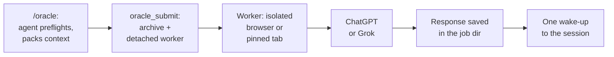

<div align="center">

<picture>
  <source media="(prefers-color-scheme: dark)" srcset="assets/logo.svg">
  <source media="(prefers-color-scheme: light)" srcset="assets/logo-light.svg">
  
</picture>

# OMP Oracle

**Send the hard question to ChatGPT or Grok. Keep working. Read the answer when it lands.**

**Works with Oh My Pi and `pi`. Uses your own ChatGPT or Grok web account, not an API key.**

Keep using [Oh My Pi](https://github.com/can1357/oh-my-pi) or `pi` in your terminal. `/oracle` packs an archive of your repository, hands it with your prompt to ChatGPT or Grok in an isolated browser session, and returns immediately. The answer is saved to disk, and the session that asked gets one wake-up when it lands.

**[Get started](#get-started)** · **[How it works](#how-it-works)** · **[Documentation](docs/README.md)** · **[Security model](docs/SECURITY.md)** · **[Compatibility](docs/COMPATIBILITY.md)** · **[Website](https://alphastorm.github.io/omp-oracle/)** · **[Changelog](CHANGELOG.md)**

[![CI][ci-badge]][ci]
[![npm][npm-badge]][npm]
[![pi baseline][pi-badge]][compat]
[![License][license-badge]][license]

[ci]: https://github.com/alphastorm/omp-oracle/actions/workflows/ci.yml
[ci-badge]: https://img.shields.io/github/actions/workflow/status/alphastorm/omp-oracle/ci.yml?branch=main&label=CI&labelColor=0B0E11
[compat]: docs/COMPATIBILITY.md
[pi-badge]: https://img.shields.io/badge/pi%20baseline-1.5.0-1C232B?labelColor=0B0E11
[npm]: https://www.npmjs.com/package/omp-oracle
[npm-badge]: https://img.shields.io/npm/v/omp-oracle?label=npm&color=1C232B&labelColor=0B0E11
[license]: LICENSE
[license-badge]: https://img.shields.io/github/license/alphastorm/omp-oracle?color=1C232B&labelColor=0B0E11

<sub><strong>Private by design:</strong> isolated browser profile · real Chrome untouched by default · secrets excluded by default · results stay on disk · no telemetry</sub>

</div>

> **Forked from [`fitchmultz/pi-oracle`](https://github.com/fitchmultz/pi-oracle) and renamed `omp-oracle`.** Commands, tools, config, and saved jobs carry over; remove `pi-oracle` before installing `omp-oracle` ([Get started](#get-started)). See [Upstream](docs/UPSTREAM.md) and [Compatibility](docs/COMPATIBILITY.md).

OMP Oracle is an extension for the Oh My Pi (OMP) and `pi` coding agents. The agent picks the files and runs the safety checks; ChatGPT or Grok does the slow second-opinion work in the background, on your own subscription. Status: experimental public beta; the support boundary is in [Compatibility](docs/COMPATIBILITY.md). Community project; not affiliated with or endorsed by the Oh My Pi maintainers, the `pi-oracle` maintainer, OpenAI, or xAI.

## What a run looks like

In a saved Oh My Pi or `pi` session, ask in plain language:

```text
/oracle Review the pending changes. Give me the highest risks first.
```

The agent checks that Oracle is ready, packs the archive, and submits one background job. The submit result names the job and the file the answer will be written to. For a ChatGPT job with the default jobs directory it includes these lines:

```text
Oracle job dispatched: <job-id>
…
Archive: /tmp/oracle-<job-id>/context-<job-id>.tar.zst
Response will be written to: /tmp/oracle-<job-id>/response.md
…
```

Your session is free again. When the provider finishes, the worker saves the answer and the session that asked gets one wake-up. If the wake-up is missed, the answer is on disk: run `/oracle-read <job-id>`.

## When to use it

Use OMP Oracle when a question needs broad repository context and minutes of provider reasoning:

- You review broad repository changes and want a slower, larger second opinion without blocking the main agent turn.
- You have a ChatGPT or Grok web subscription and want to use it from the agent instead of paying per API token.
- Migration, architecture, or failure-mode analysis benefits from a large archive of the real code and follow-ups in the same provider thread.

Use something else when:

- The task is a short local coding change the host agent can do directly.
- The project must not be uploaded to ChatGPT, Grok, or another web provider.
- You need a hosted, multi-user, or API-key-based route; this is a single-operator local tool.

<a id="build-and-run"></a>

## Get started

### 1. Install

```bash
omp install omp-oracle        # Oh My Pi
pi install npm:omp-oracle     # pi
```

If the upstream `pi-oracle` package is installed, remove it first (`omp plugin uninstall pi-oracle` or `pi remove npm:pi-oracle`) so `/oracle` and the `oracle_*` tools register once. To install from Git `main` or a local checkout, or to switch back to npm, see [Switch install source](docs/OPERATIONS.md#switch-install-source).

### 2. Check requirements

- macOS, Linux, or Windows native, with Node.js `22.19.0` or newer.
- A saved Oh My Pi or `pi` session. A `--no-session` run shows `oracle: unavailable` in the session footer.
- Google Chrome, Chromium, or another Chromium-family browser, signed in to ChatGPT or Grok in the profile you plan to use.
- `agent-browser` `0.41.2` or newer and `tar` on `PATH`; `zstd` for ChatGPT archives; on macOS, `cp` on `PATH` or `PI_ORACLE_CP_PATH`.
- On Linux, `secret-tool` (GNOME) or `kwallet-query` and `dbus-send` (KDE) to read encrypted Chromium cookies, unless you set a safe-storage password; see [Linux cookie sources](docs/OPERATIONS.md#linux).

Exact host, platform, and provider support is in [Compatibility](docs/COMPATIBILITY.md). If a tool is missing, see [A local dependency is missing](docs/OPERATIONS.md#a-local-dependency-like-agent-browser-tar-or-zstd-is-missing).

### 3. Sign in once

```text
/oracle-auth
```

This reads your default provider's cookies from your local browser profile, read-only, into an isolated auth seed profile. Each job runs in its own copy of that seed and leaves your browser window untouched. Run `/oracle-auth grok` for Grok when ChatGPT is the default provider.

Until the default provider's seed exists, the session footer shows `oracle: auth needed`. On success the command prints `Oracle auth synced.`, and the footer changes to `oracle: ready` when every requirement in step 2 is met. `oracle: config error` means one of them is missing.

For ChatGPT, two opt-in transports use a signed-in Chrome directly instead of copying cookies. Each job opens one tab of its own and drives only that tab. Deep Research needs one of them.

| Sign-in transport | Choose it when | Setup |
| --- | --- | --- |
| Existing-Chrome relay | You want jobs to run in the Chrome you already use, through a loopback relay endpoint | [Existing-Chrome relay](docs/OPERATIONS.md#existing-chrome-relay-chatgpt-only) |
| Managed browser | You want a dedicated Chrome profile that OMP Oracle starts for a job and quits when idle | [Managed ChatGPT browser](docs/OPERATIONS.md#managed-chatgpt-browser-dedicated-account) |

To keep a dedicated Chrome profile running yourself, see [Dedicated account in persistent Chrome](docs/OPERATIONS.md#dedicated-account-in-persistent-chrome). To compare all transports, see [Choose a sign-in transport](docs/OPERATIONS.md#choose-a-sign-in-transport).

### 4. Ask a first question

From inside a repository, send a small request:

```text
/oracle Read README.md and package.json. In five bullets, what does this package do?
```

The agent reports the job id and ends its turn. One wake-up arrives when the answer is saved. Until then, `/oracle-status` shows progress; afterwards, `/oracle-read <job-id>` shows the answer.

## Commands and tools

| Command | What it does |
| --- | --- |
| `/oracle <request>` | Pack a project archive, send it with your prompt to ChatGPT or Grok, and report the job id |
| `/oracle-followup <job-id> <request>` | Continue an earlier completed job in the same provider thread |
| `/oracle-auth [chatgpt\|grok]` | Sync provider cookies into the auth seed profile, or open sign-in in the managed browser |
| `/oracle-status [job-id]` | Show one job, or the latest job and recent job ids |
| `/oracle-read [job-id]` | Show job status and the first 4000 characters of the saved answer |
| `/oracle-cancel <job-id>` | Cancel a queued or active job |
| `/oracle-clean <job-id\|all>` | Remove the files of finished jobs; a job is kept for two minutes after its wake-up is sent |
| `/oracle-run <preflight\|submit\|read> …` | Run one tool from a JSON request file, without a model turn, for driver programs |

Behind `/oracle` and `/oracle-followup`, the host agent calls five tools: `oracle_preflight`, `oracle_auth`, `oracle_submit`, `oracle_read`, and `oracle_cancel`. Arguments, tool parameters, footer states, and error codes are in [Commands and tools](docs/OPERATIONS.md#commands-and-tools); `/oracle-run` is in [Driving oracle from a program](docs/OPERATIONS.md#driving-oracle-from-a-program).

Example requests:

- `/oracle Review the current pending changes. Include the whole repo unless a narrower archive is clearly better. Give me a prioritized code review with concrete fixes.`
- `/oracle Read the codebase and explain the highest-risk auth/session failure modes, including what to test before shipping.`
- `/oracle-followup <job-id> Tighten the migration plan around rollback risk, and include the most relevant surrounding files/docs as long as the archive stays comfortably within the 250 MiB limit.`
- `/oracle Continue existing ChatGPT conversation 6a28ab5c-e4d4-83e8-b8be-dd39f38a26d6. Review the current auth code and include enough surrounding context to propose concrete fixes.`

<a id="available-providers-and-presets"></a>

## Providers and presets

| Provider | How a job selects it | Archive format | Upload ceiling |
| --- | --- | --- | --- |
| ChatGPT | The default provider; takes one preset from the table below | `.tar.zst` | 250 MiB |
| Grok | Ask for Grok in your request, or set `defaults.provider` to `"grok"`; `heavy` is the only mode | `.tar.gz` | 200 MiB |

| Preset id | Label |
| --- | --- |
| `pro_standard` | Pro - Standard |
| `pro_extended` | Pro - Extended |
| `thinking_light` | Thinking - Light |
| `thinking_standard` | Thinking - Standard |
| `thinking_extended` | Thinking - Extended |
| `thinking_heavy` | Thinking - Heavy |
| `instant` | Instant |
| `instant_auto_switch` | Instant - Auto-switch to Thinking Enabled |
| `deep_research` | Deep Research |

Name a preset id or its label in your `/oracle` request. When a ChatGPT request names none, the job uses `defaults.preset`, which is `pro_extended` unless you change it. Config files take the preset id, not the label.

### Deep Research

`deep_research` is a composer tool, not a model tier: the worker turns on **Deep research** in the ChatGPT composer tools menu and leaves the model picker alone.

- It needs the existing-Chrome relay or the managed browser, and fails on the isolated seed profile.
- A run takes minutes, holds the job's tab for the whole run (the default completion timeout is 90 minutes), and consumes a Deep Research task on your account.
- The report is saved as Markdown in `response.md`. If a run fails, see [A Deep Research job failed](docs/OPERATIONS.md#a-deep-research-job-failed); how the report is collected is in [Collection](docs/ARCHITECTURE.md#collection).

## How it works



- The host agent checks the session, sign-in, and local tools, gathers context, and submits the archive. The submission starts a detached worker, or queues the job when every slot is busy, and returns.
- By default the worker runs the job in a per-job copy of the auth seed profile. On the relay or the managed browser it runs the job in one tab that it opens and closes.
- A normal `/oracle` request starts a fresh thread. `/oracle-followup` continues an earlier job, and a request can also name an existing ChatGPT conversation.
- When a job finishes and your session is idle, the session's background poller delivers one wake-up. The job directory is the durable record.

The components, the job lifecycle, and the state on disk are in [Architecture](docs/ARCHITECTURE.md).

### Recollect after a timeout

Ask the agent to run `oracle_read({ jobId, action: "recollect" })` to recover a reply without sending anything again. It waits for the bound reply to finish before collecting it and records `recollectionCompletionVerifiedAt` on success. The read is synchronous and can take the configured completion wait (90 minutes by default), plus collection and cleanup. Until it succeeds, the job keeps its original failed status and timeout text; an interrupted or expired attempt can be recollected again. Recollecting an already complete job's artifacts does not set the field. See [Recollect a finished answer](docs/OPERATIONS.md#recollect-a-finished-answer).

<a id="privacy-and-security"></a>

## What leaves your machine

- **One upload per job.** A job sends your prompt and one compressed archive of project files to ChatGPT or Grok, through the provider's web app, under your account.
- **The agent chooses the files.** For a broad request it archives the whole project. Name the paths in your request to narrow the archive.
- **Default exclusions.** Archive inputs must resolve inside the project without symlink escapes. When a directory is expanded, `.git`, `.omp`, `.pi`, `node_modules`, `secrets/`, `.env` files, private keys, and databases are skipped. A path you name explicitly is archived as named.
- **The project root.** Paths resolve against the project root: the nearest directory, from the working directory upward, that is a Git repository or holds the host's config directory (`.omp` or `.pi`) or an `AGENTS.md`. The search stops below your home directory, so the home directory never becomes the project of a directory under it. In the home directory itself, a whole-project archive (`.`) is refused.
- **Your browser.** By default `/oracle-auth` reads your browser cookies read-only into an isolated auth seed profile, and each job runs in a copy that is deleted when the job exits. The relay and the managed browser copy no cookies, own one tab per job, and never quit a Chrome that OMP Oracle did not start.
- **Local files.** Job files are private to your user. The extension has no telemetry and no hosted control plane.

The full list of exclusions, the credential boundaries, and what the defaults do not cover are in the [Security model](docs/SECURITY.md). To report a vulnerability, see the [Security policy](SECURITY.md).

## Configuration

Oracle works without a config file. Create one to change the default provider or preset, pick a browser profile, or set up a sign-in transport.

| Host | Agent-level config | Project config |
| --- | --- | --- |
| Oh My Pi | `~/.omp/agent/extensions/oracle.json` | `.omp/extensions/oracle.json` |
| `pi` | `~/.pi/agent/extensions/oracle.json` | `.pi/extensions/oracle.json` |

```json
{
  "defaults": {
    "provider": "chatgpt",
    "preset": "pro_extended",
    "grokMode": "heavy"
  },
  "auth": { "chromeProfile": "Default" }
}
```

A project file may set only `defaults`, `worker`, `poller`, `artifacts`, and `cleanup`. `browser` and `auth` are agent-level only, and a project file that sets any other key is rejected. Every key, default, and environment variable is in the [Configuration reference](docs/OPERATIONS.md#configuration-reference); file locations and project trust are in [Config files](docs/OPERATIONS.md#config-files).

## Compatibility

| Surface | Support |
| --- | --- |
| Hosts | Oh My Pi and `pi`. `pi` `1.5.0` is the tested baseline; the `pi` runtime packages are optional wildcard peer dependencies, so npm does not block other host versions |
| Platforms | macOS and Ubuntu are required by the release gate; Windows native is validated upstream, not re-qualified by this fork |
| Providers | ChatGPT (nine presets) and Grok (`heavy`) |
| Sign-in transports | Isolated seed profile for both providers; existing-Chrome relay and managed browser for ChatGPT |
| Package | `omp-oracle` on npm; a GitHub URL install tracks `main` |

- **Experimental public beta.** Provider pages, sign-in flows, model controls, and artifact downloads can change without notice.
- **Wake-ups are best effort.** The session poller delivers one wake-up per finished job once the session is idle. The job directory on disk is the durable record.

The full matrix and the known limits are in [Compatibility](docs/COMPATIBILITY.md) and [Known limits](docs/COMPATIBILITY.md#known-limits). Dated qualification records are in the [release ledger](docs/RELEASE.md#evidence-ledger).

## Documentation

- **Use it:** [Operations](docs/OPERATIONS.md) covers setup, sign-in transports, working with jobs, troubleshooting, and the configuration reference.
- **Evaluate it:** [Compatibility](docs/COMPATIBILITY.md), the [Security model](docs/SECURITY.md), and the [Security policy](SECURITY.md).
- **Build on it:** [Architecture](docs/ARCHITECTURE.md), [Test plan](docs/TEST_PLAN.md), and [Contributing](CONTRIBUTING.md).
- **Maintain it:** [Platform smoke](docs/PLATFORM_SMOKE.md), [Release](docs/RELEASE.md), [Upstream](docs/UPSTREAM.md), and [Branding](docs/BRANDING.md).
- **Dated records:** the [Changelog](CHANGELOG.md) and the [release ledger](docs/RELEASE.md#evidence-ledger).

The [documentation index](docs/README.md) lists every document by task.

## Contributing

Run the local gate before you open a pull request:

```bash
npm run verify:oracle
```

[Contributing](CONTRIBUTING.md) covers the workflow and the [repository layout](CONTRIBUTING.md#repository-layout). [Which check to run](docs/TEST_PLAN.md#which-check-to-run) maps each kind of change to the check that proves it.

## Credits

1. **[`pi-oracle`](https://github.com/fitchmultz/pi-oracle)** by Mitch Fultz — the extension this fork is built on: the isolated-profile architecture, the job model, the prompts, and the validation harness. MIT.
2. **[Oh My Pi](https://github.com/can1357/oh-my-pi)** by can1357 and **[`pi`](https://github.com/badlogic/pi-mono)** by Mario Zechner — the hosts. MIT.
3. **[agent-browser](https://www.npmjs.com/package/agent-browser)** and **[`@steipete/sweet-cookie`](https://www.npmjs.com/package/@steipete/sweet-cookie)** — the browser driver and the cookie importer.

Sibling projects: [OMP NInfer](https://github.com/alphastorm/omp-ninfer) · [OMP Session Gateway](https://github.com/alphastorm/omp-session-gateway).

## License

MIT. See [LICENSE](LICENSE).
