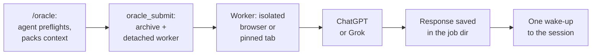

<div align="center">

<picture>
  <source media="(prefers-color-scheme: dark)" srcset="assets/logo.svg">
  <source media="(prefers-color-scheme: light)" srcset="assets/logo-light.svg">
  
</picture>

# OMP Oracle

**Send the hard question to ChatGPT or Grok. Keep working. Read the answer when it lands.**

**Works with Oh My Pi and `pi`. Uses your own ChatGPT or Grok web account, not an API key.**

Keep using [Oh My Pi](https://github.com/can1357/oh-my-pi) or `pi` in your terminal. `/oracle`
packs a context-rich archive of the repository, hands it with your prompt to ChatGPT or Grok in
an isolated browser session, and returns immediately. The answer is saved to disk, and the
session that asked gets one wake-up when it lands.

**[Build and run](#build-and-run)** · **[How it works](#how-it-works)** ·
**[Documentation](docs/README.md)** · **[Security model](docs/SECURITY.md)** ·
**[Compatibility](docs/COMPATIBILITY.md)** · **[Website](https://alphastorm.github.io/omp-oracle/)** ·
**[Changelog](CHANGELOG.md)**

[![CI][ci-badge]][ci]
[![npm][npm-badge]][npm]
[![pi baseline][pi-badge]][compat]
[![License][license-badge]][license]

[ci]: https://github.com/alphastorm/omp-oracle/actions/workflows/ci.yml
[ci-badge]: https://img.shields.io/github/actions/workflow/status/alphastorm/omp-oracle/ci.yml?branch=main&label=CI&labelColor=0B0E11
[compat]: docs/COMPATIBILITY.md
[pi-badge]: https://img.shields.io/badge/pi%20baseline-0.80.9-1C232B?labelColor=0B0E11
[npm]: https://www.npmjs.com/package/omp-oracle
[npm-badge]: https://img.shields.io/npm/v/omp-oracle?label=npm&color=1C232B&labelColor=0B0E11
[license]: LICENSE
[license-badge]: https://img.shields.io/github/license/alphastorm/omp-oracle?color=1C232B&labelColor=0B0E11

<sub><strong>Private by design:</strong> isolated browser profile · real Chrome untouched by default ·
secrets excluded by default · results stay on disk · no telemetry</sub>

</div>

> **Forked from [`fitchmultz/pi-oracle`](https://github.com/fitchmultz/pi-oracle) and renamed `omp-oracle`.**
> Commands, tools, config, and saved jobs carry over; remove `pi-oracle` before installing `omp-oracle` ([Build and run](#build-and-run)).
> See [Upstream](docs/UPSTREAM.md) and [Compatibility](docs/COMPATIBILITY.md).

OMP Oracle is a local-first companion for Oh My Pi and `pi`: the host agent keeps control of context selection and safety checks, and ChatGPT or Grok does the slow second-opinion work in the background on your own subscription. Status: experimental public beta; the exact support boundary is in [Compatibility](docs/COMPATIBILITY.md).

This is a community project and is not affiliated with or endorsed by the Oh My Pi maintainers, OpenAI, or xAI.

## What a successful run looks like

```text
You: /oracle Review the pending changes.
     Include the whole repo unless a narrower archive is clearly better.

omp-oracle:
  1. preflights local session/auth readiness
  2. builds a context-rich provider archive (`.tar.zst` for ChatGPT, `.tar.gz` for Grok)
  3. starts an isolated provider web runtime in the background
  4. uploads the archive and prompt to the selected provider
  5. saves the response/artifacts under /tmp/oracle-<job-id>/
  6. sends a best-effort wake-up back to the matching session

Later: /oracle-read <job-id>
```

If the wake-up is missed, the result still lives on disk and can be read by job id.

## Use it when

- You review broad repository changes and want a slower, larger second opinion without blocking the main agent turn.
- You have a ChatGPT or Grok web subscription and want to use it from the agent instead of paying per API token.
- Migration, architecture, or failure-mode analysis benefits from a large archive of the real code and follow-ups in the same provider thread.

## Use something else when

- The task is a short local coding change the host agent can do directly.
- The project must not be uploaded to ChatGPT, Grok, or another web provider.
- You need a hosted, multi-user, or API-key-based route; this is a single-operator local tool.

## Build and run

### 1. Install

```bash
omp install omp-oracle        # Oh My Pi
pi install npm:omp-oracle     # pi
```

If the upstream `pi-oracle` package is installed, remove it first (`omp plugin uninstall pi-oracle` or `pi remove npm:pi-oracle`) so `/oracle` and the `oracle_*` tools register once. For Git `main` tracking, local-checkout installs, or switching back to a registry release, see [Operations → Switch install source](docs/OPERATIONS.md#switch-install-source).

### 2. Check requirements

- macOS, Linux, or Windows native.
- Node.js 22.19.0 or newer to install and run; platform smoke and release validation expect Node 24+ per `platform-smoke.config.mjs`.
- Google Chrome, Chromium, or another Chromium-family browser, signed in to ChatGPT or Grok in the profile you plan to use.
- `agent-browser` and `tar` on the machine; `zstd` for ChatGPT `.tar.zst` archives; on macOS, `cp` on `PATH` or `PI_ORACLE_CP_PATH` for APFS clone mode.
- Start a normal persisted `pi` session (or Oh My Pi session) before using `/oracle`; `--no-session` runs report oracle unavailable.
- On Linux, encrypted Chromium cookies may need `secret-tool` (GNOME/libsecret) or `kwallet-query` + `dbus-send` (KDE), unless a safe-storage password override is set for the auth run.

Exact host, platform, and provider support: [Compatibility](docs/COMPATIBILITY.md).

### 3. Sync provider auth once

```text
/oracle-auth
```

This imports cookies for your configured default provider from your local browser profile into an isolated auth seed profile; each job clones that seed and leaves your active browser window untouched. Run `/oracle-auth grok` to refresh the Grok seed when ChatGPT is the default provider.

To drive an already signed-in Chrome instead of copying cookies, set the agent-level relay option and skip `/oracle-auth` for ChatGPT; each job owns one pinned tab and closes it on cleanup ([Operations → Existing-Chrome relay](docs/OPERATIONS.md#existing-chrome-relay-chatgpt-only)):

```json
{ "browser": { "chatGptRelayEndpoint": "http://127.0.0.1:9224" } }
```

To use a separate work account without changing personal Chrome, configure a [managed ChatGPT browser](docs/OPERATIONS.md#managed-chatgpt-browser-dedicated-account) so `/oracle-auth` opens sign-in there and Oracle starts and quits that Chrome around jobs:

```json
{
  "browser": {
    "chatGptManagedProfileDir": "~/Library/Application Support/omp-oracle/chatgpt-profile"
  }
}
```

To keep a dedicated Chrome running yourself over native CDP instead, see [Dedicated account in persistent Chrome](docs/OPERATIONS.md#dedicated-account-in-persistent-chrome).

### 4. Submit a tiny job

```text
/oracle Read README.md and package.json. In five bullets, what does this package do?
```

Expected result:

- The `/oracle` prompt now runs an early oracle preflight before expensive repo reading or archive creation.
- The agent chooses a context-rich relevant archive up to the selected provider's upload ceiling, not the smallest possible one-file slice when nearby context helps.
- `oracle_submit` creates or queues a job; if local packing exceeds the ceiling, the prompt treats that as a retryable archive-selection failure and narrows automatically before surfacing the problem.
- The job uploads a repo archive to the selected provider, capped at 250 MiB for ChatGPT or 200 MiB for Grok after default exclusions and pruning, saves `/tmp/oracle-<job-id>/response.md`, and sends one best-effort wake-up to the asking session.

If the wake-up does not arrive:

```text
/oracle-status
/oracle-read <job-id>
```

## Commands and tools

User-facing commands:

- `/oracle <request>` — prepare context and dispatch a ChatGPT or Grok web oracle job. It starts a fresh thread unless the request names an existing ChatGPT conversation id or URL.
- `/oracle-followup <job-id> <request>` — continue an earlier oracle job in the same provider thread.
- `/oracle-auth [chatgpt|grok]` — sync provider cookies into the isolated auth seed profile, or open ChatGPT sign-in in the managed browser (refused in relay mode).
- `/oracle-read [job-id]` — inspect job status and the saved response preview.
- `/oracle-status [job-id]` — inspect a job, or list recent job ids when no explicit id is given.
- `/oracle-cancel <job-id>` — cancel a queued or active job.
- `/oracle-clean <job-id|all>` — remove temp files for terminal jobs; recently woken terminal jobs may stay retained briefly, and a blocked cleanup returns the next eligible cleanup time.

Agent-facing tools:

- `oracle_preflight` — checks persisted-session readiness, local prerequisites, and global active/queued job capacity before expensive context gathering.
- `oracle_auth` — runs the `/oracle-auth` flow for agents; agent callers can use `oracle_auth({})` once before retrying a stale-auth submission.
- `oracle_submit` — builds the archive and dispatches or queues the job; `chatGptConversationId` is optional and only for continuing an explicitly named ChatGPT browser thread.
- `oracle_read` — Agent callers can use `oracle_read({ jobId })` for status when the user asks before the completion wake-up, or to read saved output in-turn. Do not poll; otherwise wait for the one-time wake-up in the submitting session. Use `oracle_read({ jobId, action: "recollect" })` to retry collection of a completed turn without resending the prompt. Failed jobs include `errorCode` and `prompt-send-state`, and completed turns report `generationStatus`, `collectionStatus`, and `response.capture.json`; see [Operations → Troubleshooting](docs/OPERATIONS.md#troubleshooting).
- `oracle_cancel` — cancels a queued or active job by id.

Jobs submitted by a helper from another project are discoverable by id within the same
`${PI_ORACLE_JOBS_DIR:-/tmp}`. A read from the wrong project returns the owning root and requires an
explicit retry: `oracle_read({ jobId, projectId: "/path/used/at/submit" })`. The slash commands accept
`/oracle-status <job-id> --projectId "/path/used/at/submit"` and the same option on `/oracle-read`.
No response from another project is returned without that acknowledgment; cancel and cleanup stay
current-project only.

`oracle_read` and `/oracle-status` show the worker's `observedSelection`, not just the requested
preset: `product`, `modelLabel` (model-selector text), `effortLabel`, `deepResearchVerified`,
`deepResearchIframeTitle`, and `at` when observed. Deep Research uses its own product, so it does
not borrow the ordinary model picker's label. These optional UI-control facts contain no answer
text or credentials; old jobs without them remain readable.

### Example requests

- `/oracle Review the current pending changes. Include the whole repo unless a narrower archive is clearly better. Give me a prioritized code review with concrete fixes.`
- `/oracle Read the codebase and explain the highest-risk auth/session failure modes, including what to test before shipping.`
- `/oracle Explain the README guidance for /oracle-clean retention grace. Archive README.md plus any nearby docs or implementation files that help answer accurately.`
- `/oracle-followup <job-id> Tighten the migration plan around rollback risk, and include the most relevant surrounding files/docs as long as the archive stays comfortably within the 250 MiB limit.`
- `/oracle Continue existing ChatGPT conversation 6a28ab5c-e4d4-83e8-b8be-dd39f38a26d6. Review the current auth code and include enough surrounding context to propose concrete fixes.`

## How it works



- **Agent preflights, then gathers a context-rich relevant repo slice.** `/oracle` and `/oracle-followup` keep the visible transcript compact while hidden dispatch instructions guide the agent through preflight, context gathering, and archive input selection.
- **Tools own execution.** `oracle_submit` builds the archive, admits or queues the job, starts a detached worker, and returns immediately.
- **Three auth transports are supported.** Jobs clone the isolated auth seed profile from `/oracle-auth` by default, or drive one job-owned pinned tab in your signed-in Chrome via the relay or in a dedicated managed browser.
- **Follow-ups and existing threads are explicit.** Normal `/oracle` jobs still start a fresh provider thread, while `/oracle-followup` continues a prior job with `followUpJobId` and explicit browser conversation ids or URLs pass `chatGptConversationId`.
- **Wake-up is best effort, storage is durable.** The session poller delivers one idle-gated wake-up when a job finishes, while the job directory on disk retains the result even if the wake-up is missed.

Full detail: [Architecture](docs/ARCHITECTURE.md) · [Security model](docs/SECURITY.md) · [Operations](docs/OPERATIONS.md).

## Configuration

Most users can start with the defaults: ChatGPT, the `pro_extended` preset, Grok `heavy`. Set agent-level or project config only to change a default, a browser profile, or a transport:

| Host | Agent-level config | Project overrides |
| --- | --- | --- |
| Oh My Pi | `~/.omp/agent/extensions/oracle.json` | `.omp/extensions/oracle.json` |
| `pi` | `~/.pi/agent/extensions/oracle.json` | `.pi/extensions/oracle.json` |

```json
{
  "defaults": {
    "provider": "chatgpt",
    "preset": "<preset id from ORACLE_SUBMIT_PRESETS>",
    "grokMode": "heavy"
  },
  "auth": { "chromeProfile": "Default" }
}
```

- `defaults.provider` is `chatgpt` or `grok`; `defaults.preset` is the default ChatGPT preset and `defaults.grokMode` the Grok mode (`heavy` is the only mode). Canonical ids live in [`extensions/oracle/lib/config.ts`](extensions/oracle/lib/config.ts).
- When an agent is unsure which preset fits, it should omit `preset` and use the configured default model instead of asking; if the prompt asks for Grok, it passes `provider: "grok"`.
- A project file may set only `defaults`, `worker`, `poller`, `artifacts`, and `cleanup`; `browser` and `auth` are agent-level only. Project config loads by default and is ignored when you opt out with `--no-approve` or save a "do not trust" decision.
- Linux cookie import uses Sweet Cookie's keyring options (`SWEET_COOKIE_LINUX_KEYRING` and safe-storage password overrides), so leave `auth.chromiumKeychain` unset there; macOS users of another Chromium-family browser pair `auth.chromeCookiePath` with `auth.chromiumKeychain`.

Full key reference, cookie sources, environment variables, and retention: [Operations → Configuration reference](docs/OPERATIONS.md#configuration-reference).

## Available providers and presets

| Provider | Mode / preset | Archive format | Upload ceiling |
| --- | --- | --- | --- |
| ChatGPT | Presets below | `.tar.zst` | 250 MiB |
| Grok | `heavy` only | `.tar.gz` | 200 MiB |

| Preset id | Label |
| --- | --- |
| `pro_standard` | Pro - Standard |
| `pro_extended` | Pro - Extended |
| `thinking_light` | Thinking - Light |
| `thinking_standard` | Thinking - Standard |
| `thinking_extended` | Thinking - Extended |
| `thinking_heavy` | Thinking - Heavy |
| `instant` | Instant |
| `instant_auto_switch` | Instant - Auto-switch to Thinking Enabled |
| `deep_research` | Deep Research |

For ChatGPT, `oracle_submit` accepts canonical preset ids or a matching human-readable preset label; keep config values on canonical ids. Grok uploads now use `.tar.gz` archives because Grok's execution environment can lack `zstd`, and manual testing accepted a 200 MiB upload and rejected 200 MiB + 1 byte.

### Deep Research

`deep_research` is a composer-tool preset, not a model tier: the worker enables **Deep research** in the ChatGPT composer tools menu and leaves the model picker alone.

- It needs a shared Chrome transport (the existing-Chrome relay or the managed browser) and fails on the isolated seed profile.
- A run takes minutes, holds the job's pinned tab for the whole run (90-minute default completion timeout), and consumes a Deep Research task on your account, so `deep_research` is excluded from the release preset proof.
- The report is saved as Markdown: from the native export when it can be collected, otherwise from the research widget itself. Use `oracle_read({ jobId, action: "recollect" })` to retry collection rather than resubmitting.

The three `deep_research_*` failure codes and what to do about them: [Operations → Troubleshooting](docs/OPERATIONS.md#troubleshooting). Frame capture and export collection internals: [Architecture → Collection](docs/ARCHITECTURE.md#collection).

## Privacy and security

- **Explicit per-job uploads:** Oracle sends your prompt and one project archive per job to the selected provider through its web app under your account.
- **Default archive exclusions:** archive inputs must resolve inside the project without symlink escapes; `.git`, tool state, `secrets/`, `.env*`, private keys, and databases are excluded by default when directories are expanded, while an explicitly named path is archived as named.
- **Isolated browser profile by default:** `/oracle-auth` reads your browser cookie store read-only into an isolated seed profile, and each job runs in a per-job clone deleted on exit.
- **Scoped shared-Chrome transports:** relay and managed-browser modes copy no cookies, own one pinned tab per job, fail closed on a mismatched target, and never quit a Chrome instance Oracle did not start.
- **Private local state:** job state is written atomically with private file permissions, project config cannot override `browser` or `auth`, and the extension includes no telemetry, analytics, or hosted control plane.

See the [Security model](docs/SECURITY.md) and the [Security policy](SECURITY.md).

## Compatibility

| | Current contract |
| --- | --- |
| Hosts | Oh My Pi and `pi`. Pi `0.80.9+` is the suggested tested floor; the `pi` runtime packages are optional wildcard peers, so npm does not block newer hosts |
| Platforms | macOS and Linux pass the release gate; Windows native is declared and validated upstream, not re-qualified by this fork |
| Providers | ChatGPT (nine presets) and Grok (`heavy`) |
| Transports | Isolated seed profile for both providers; existing-Chrome relay and managed browser for ChatGPT |
| Package | `omp-oracle` `0.4.5` on npm; the GitHub URL tracks `main` |

- **Experimental public beta:** provider UI, auth, model controls, and artifact download behavior can drift.
- **Wake-up is best effort:** the session poller delivers one idle-gated wake-up per finished job, while the job directory on disk is the durable record.

See [Compatibility](docs/COMPATIBILITY.md) and [Known limits](docs/COMPATIBILITY.md#known-limits) for the full matrix and boundaries, and the [release ledger](docs/RELEASE.md#evidence-ledger) for dated qualification records.

## Verify a change

```bash
npm run verify:oracle        # everyday local gate; `npm test` is an alias
```

| Situation | Command(s) |
| --- | --- |
| Everyday local iteration | `npm run verify:oracle` |
| Platform-focused syntax/invariant sanity | `npm run check:platform-smoke`, `npm run sanity:oracle:platform` |
| Platform-sensitive runtime changes | `npm run smoke:platform:doctor`, then `node scripts/platform-smoke.mjs run --target <target> --suite <suite>` |
| Platform matrix proof | `npm run smoke:platform:all` |
| ChatGPT preset release proof check | `npm run release:proof:chatgpt-presets` |
| Publish/release gate | `npm run release:check` |
| Brand artwork, after editing `assets/*.html` | `npm run render:assets`, then `npm run render:assets -- --check` |

`npm publish` is guarded by `prepublishOnly`, which runs `npm run release:check`: the local gate, the ChatGPT preset proof check across the eight model presets (`deep_research` is excluded because each run costs a Deep Research task), and `npm run smoke:platform:all`. Choose the right validation check in [Test plan → Which check to run](docs/TEST_PLAN.md#which-check-to-run); see [`docs/PLATFORM_SMOKE.md`](docs/PLATFORM_SMOKE.md) and [Release](docs/RELEASE.md).

## Contributing

See [Contributing](CONTRIBUTING.md) for workflow, verification rules, and the [repository layout](CONTRIBUTING.md#repository-layout), along with [Release](docs/RELEASE.md), [Upstream](docs/UPSTREAM.md), and the [Security policy](SECURITY.md).

## Credits

1. **[`pi-oracle`](https://github.com/fitchmultz/pi-oracle)** by Mitch Fultz — the extension this fork is built on: the isolated-profile architecture, the job model, the prompts, and the validation harness. MIT.
2. **[Oh My Pi](https://github.com/can1357/oh-my-pi)** by can1357 and **[pi](https://github.com/badlogic/pi-mono)** by Mario Zechner — the hosts. MIT.
3. **[agent-browser](https://www.npmjs.com/package/agent-browser)** and **[`@steipete/sweet-cookie`](https://www.npmjs.com/package/@steipete/sweet-cookie)** — the browser driver and the cookie importer.

Sibling projects: [OMP NInfer](https://github.com/alphastorm/omp-ninfer) · [OMP Session Gateway](https://github.com/alphastorm/omp-session-gateway).

## License

MIT. See [LICENSE](LICENSE).
